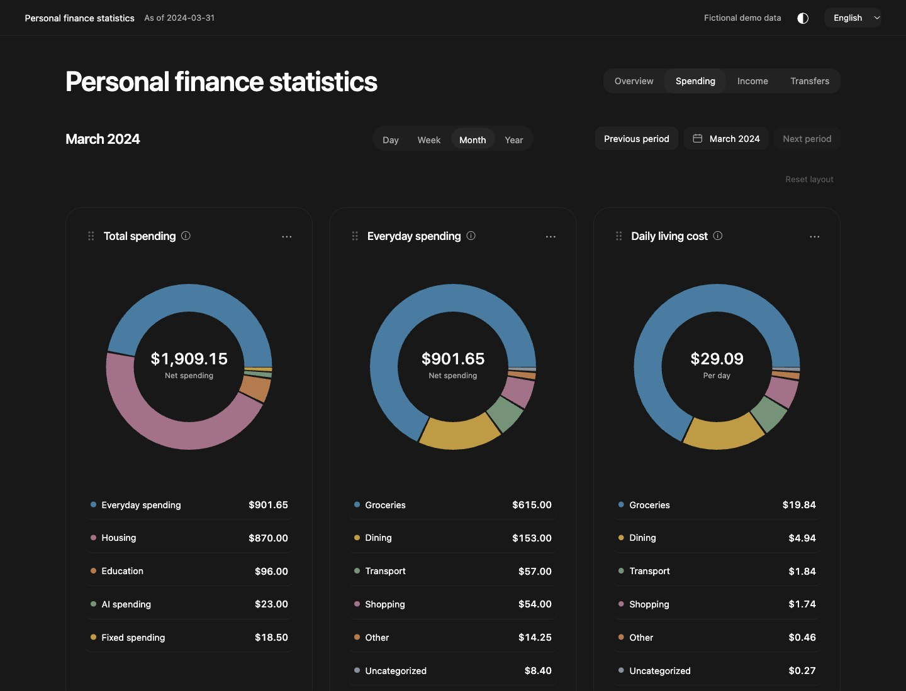
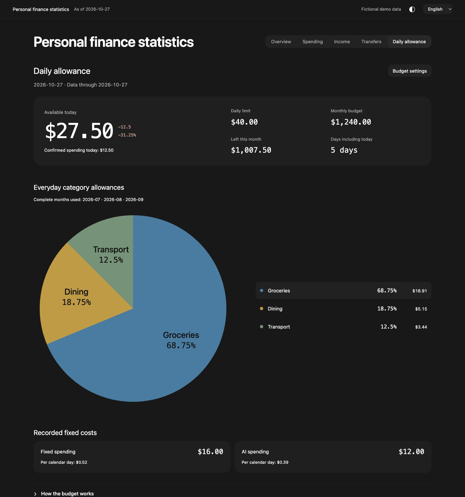
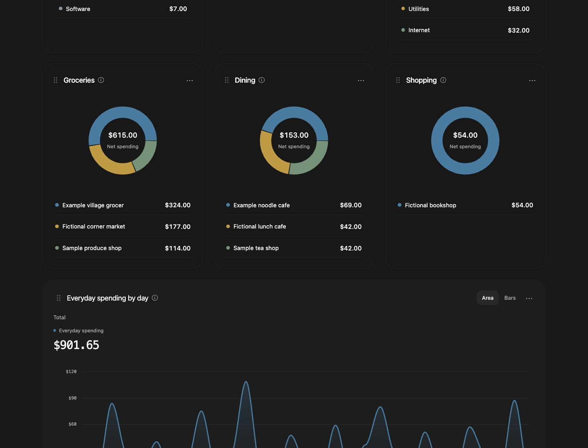
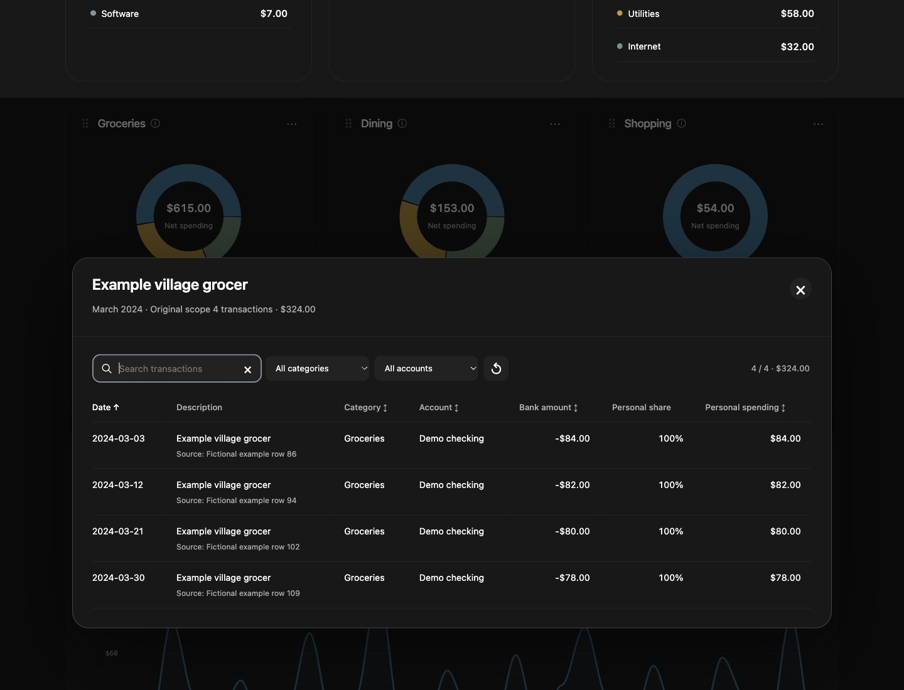
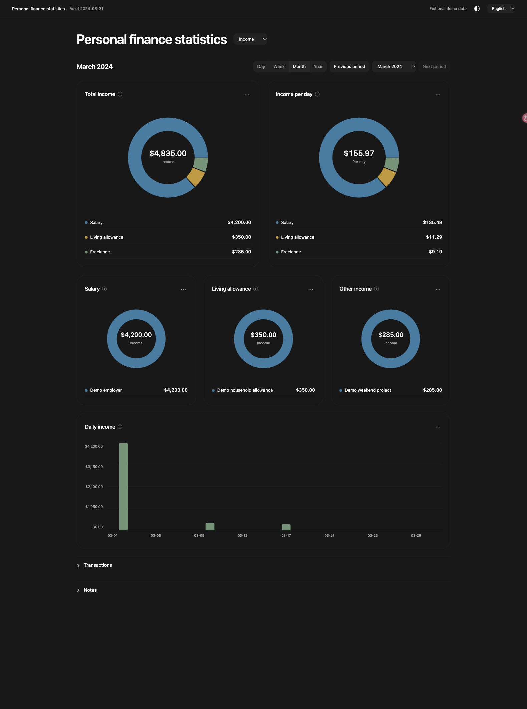
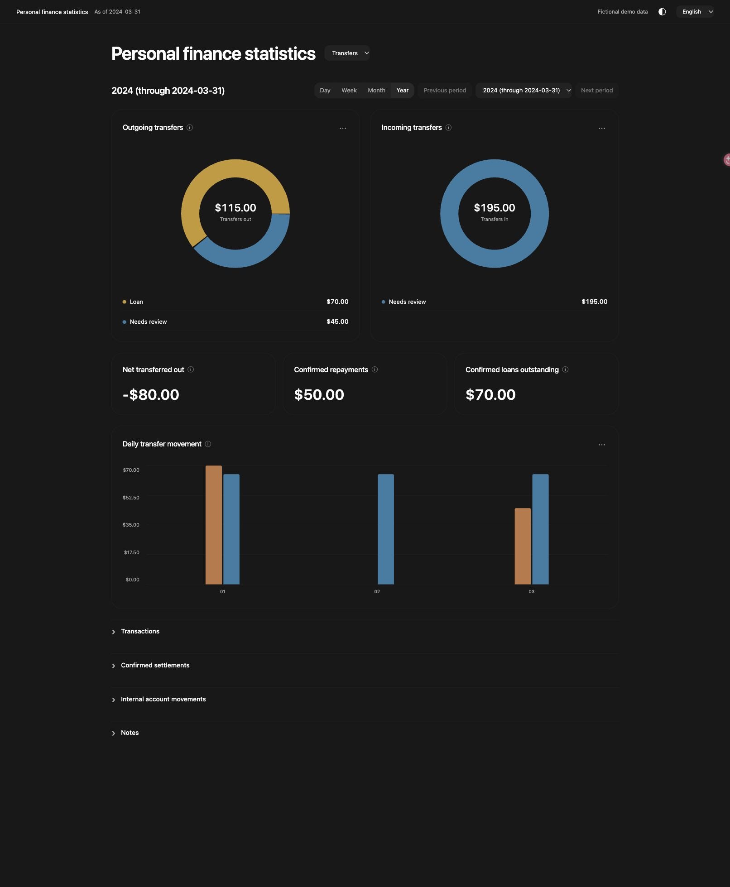
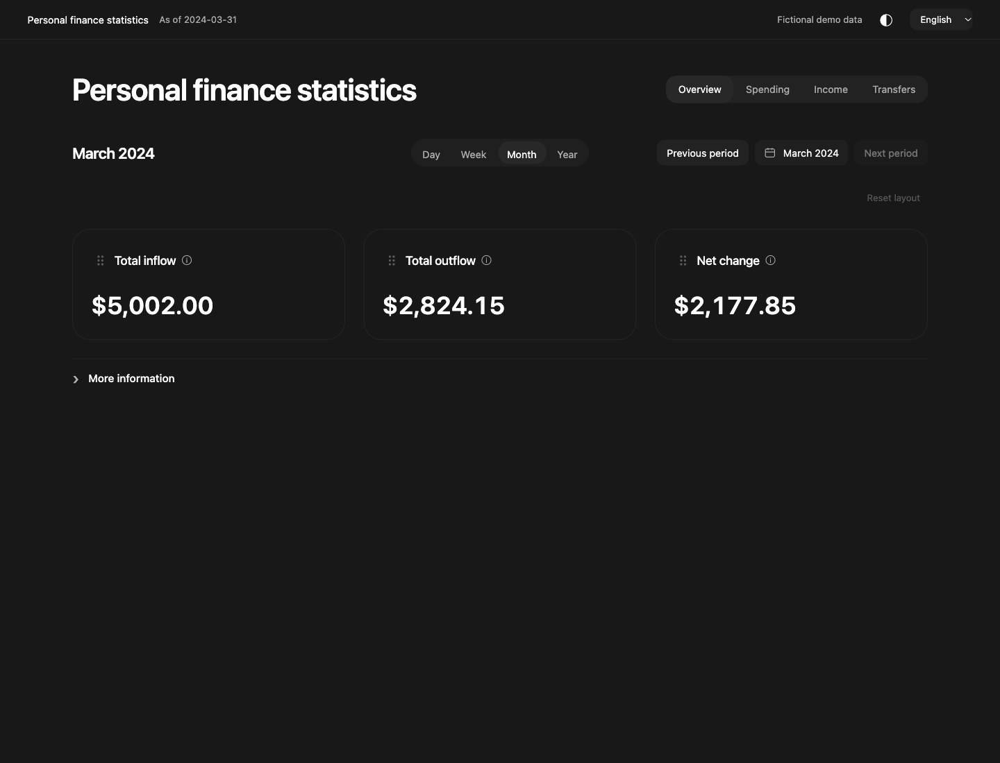
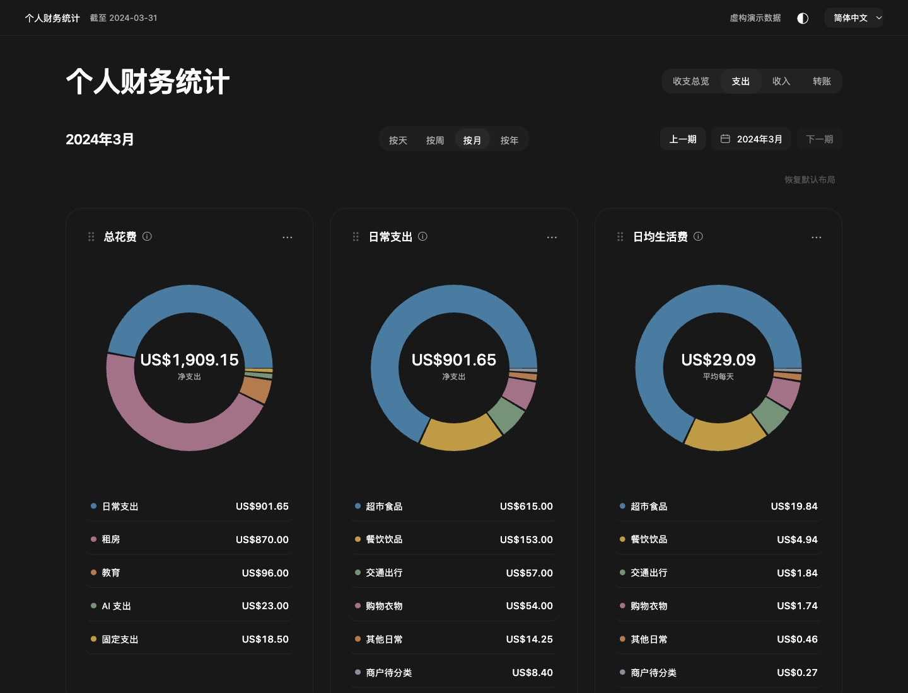

# Personal Finance Visualizer

[简体中文](README.zh-CN.md) · [Agent Skill](skills/personal-finance-visualizer/SKILL.md) · [Input schema](skills/personal-finance-visualizer/references/schema.md) · [ClawHub](https://clawhub.ai/jasonhmy/skills/personal-finance-visualizer)

[Visual guide](docs/visual-guide.md) · [Install](#install-as-an-agent-skill) · [Download](https://github.com/JasonHMY/personal-finance-visualizer/releases/latest)

Turn user-provided finance records into an interactive local report. Explore spending, income, transfers and cash movement by day, week, month or year, then open the transactions behind a total.




Cards stay visible during transitions. Rings and amounts animate continuously; list entries appear in order. Optional `merchantDisplayNames` provides short display/search names without changing original merchants, grouping or accounting.

## Daily allowance

Optionally add a daily upper limit and a calendar-month budget. The report spreads the remaining budget over remaining days, applies confirmed personal shares and refunds, and offers historical or manual category reference shares. Incomplete month coverage or data older than yesterday blocks a usable current allowance. Choose the limit, currency, timezone and included groups with the user; the USD 40 demo is fictional.

The allowance shows its amount and percentage change from yesterday’s opening allowance under the current settings. Category references use a clickable pie chart: unclassified categories stay out of the split, while their spending still counts. User-confirmed pending purchases count toward spending and budgets, are labelled in details, and remain outside bank cash movement until posted. Replace a pending record only on clear matching evidence; ask about amount changes or cancellations.

Standalone settings apply only in the current page's memory. Cross-device saving is an optional integration requiring separately authorized private hosting, login protection, a same-origin API and private storage. It is not enabled by installing this Skill. See the [adapter guide](examples/private-budget-service/README.md).

```bash
python3 demo/budget_demo.py | python3 skills/personal-finance-visualizer/scripts/report.py --input -
```

Open the resulting local URL and choose **Daily allowance**. The generator uses invented records dated relative to today in UTC; it never reads financial files.



## What it does

On phones (700px or narrower), ring and metric cards use two columns at half scale with a 12px gap. Timelines and details keep the full row; drag reordering accounts for the scaled cards. Desktop layout is unchanged.

- Four views: overview, spending, income and transfers.
- Daily, weekly, monthly and yearly periods, clipped to confirmed data coverage. Weeks start on Monday.
- English and Simplified Chinese controls, with transaction details and compact, expandable explanations.
- Separate bank-date cash movement from personal spending, confirmed full refunds and shared expenses.
- Accept normalized JSON/CSV; run in memory by default or export a standalone local HTML file on request.
- No runtime packages beyond Python's standard library. The report uses plain HTML, CSS and JavaScript.

It does not connect to banks, request credentials, move money or manage subscriptions. Raw bank CSV needs a known field mapping; PDF extraction depends on the agent's available tools and must be reconciled before use. This is not a universal bank-statement parser.

The bundled template preserves a circular report layout: three primary spending rings, three secondary rings, merchant breakdowns, a timeline and collapsed details. View buttons sit beside the title. Income, transfers and overview each retain their own layout. Dark mode is the default, with a local light-mode toggle. The skill uses this template directly instead of redesigning the report for each request.

Reorder cards within each view by dragging their headers or using the keyboard. Layout order is saved locally without plaintext category names. Use the date picker to choose covered days, weeks, months or years, and switch trends between area and bar charts. Secondary tables and notes stay inside collapsed More information.

## From a total to the payments behind it

**Compare merchants within a category.** Everyday merchant cards stay below the main spending rings. The merchant rings show which providers make up each category; the timeline below shows when everyday spending occurred.



**Open the actual rows.** Select a ring segment or a category row to see dates, source references, original bank amounts and personal shares. Search, filter by category or account, and sort columns inside the detail window without losing the selected period. The total follows the filtered rows.



## Income, transfers and the cash overview

Income separates salary, living allowance and other receipts. Transfers show external movements, confirmed repayments and outstanding confirmed loans. These views keep transfers separate from income and spending.

<table>
<tr><th>Income</th><th>Transfers</th></tr>
<tr>
<td width="50%"><a href="demo/income-en.jpg"></a></td>
<td width="50%"><a href="demo/transfers-en.jpg"></a></td>
</tr>
</table>

The overview answers a different question: how much came in, how much went out, and what changed during the period. Click a total to inspect its transactions. It is a view of supplied-account cash movement, not an account balance or net-worth calculation.



All screenshots use invented records. [Open the visual guide](docs/visual-guide.md) for the complete page walkthrough, calculation notes, Chinese interface, light theme and narrow-screen layout. Click any screenshot to inspect it at full size.

## Install as an Agent Skill

The report requires **Python 3.10+** and a modern browser. The optional [`skills` installer](https://github.com/vercel-labs/skills) currently requires **Node.js 22.20+**; Node is not needed to run the report.

```bash
DISABLE_TELEMETRY=1 npx skills add JasonHMY/personal-finance-visualizer --skill personal-finance-visualizer --global
```

Choose your agent when prompted. `DISABLE_TELEMETRY=1` disables the installer's telemetry and security-audit requests. Installation still downloads public code from network services.

For manual installation, clone or download this repository, then copy or symlink `skills/personal-finance-visualizer/` into your agent's supported skill directory. Keep the bundled scripts, references and assets together. The agent must support reading Agent Skills and running local Python.

Example requests:

> Use personal-finance-visualizer to make an English report from these authorized records. Show monthly spending and keep the report in memory.

> 用 personal-finance-visualizer 把我提供的记录做成中文报表，看看每周花销。先在内存里展示，不保存文件。

The agent uses your request's language for both the response and initial interface, unless you choose another language.

## Try the fictional demo

From the repository root:

```bash
python3 skills/personal-finance-visualizer/scripts/report.py --demo --language en
python3 skills/personal-finance-visualizer/scripts/report.py --demo --language zh-CN
```

The command prints a tokenized loopback URL. Open it in your browser and keep the process running while reviewing; stop it with Ctrl+C when finished. This mode creates no report file.



All demo transactions are invented. Their generator is [`scripts/demo_data.py`](skills/personal-finance-visualizer/scripts/demo_data.py), and the reproducible sample is [`demo/sample.json`](demo/sample.json). Screenshots show only this fictional dataset.

## Use your own normalized records

```bash
python3 skills/personal-finance-visualizer/scripts/report.py --input /local/normalized.json --language en
python3 skills/personal-finance-visualizer/scripts/report.py --input /local/normalized.csv --currency USD --start 2024-01-01 --end 2024-03-31 --language zh-CN
```

`--input -` accepts JSON on standard input, allowing an agent to pass normalized records without an intermediate file. For an installed copy, replace the repository-relative script path with the installed skill path.

Read the [schema](skills/personal-finance-visualizer/references/schema.md) for fields, sign conventions, CSV headers, refund matches and transfer settlements. Read the [workflow](skills/personal-finance-visualizer/references/workflow.md) for extraction and reconciliation. Version 1 uses one currency per report and supports currencies with two decimal places; it does not convert currencies.

Check coverage, duplicates and bank totals before charting. For unclear transaction purposes, categories or matches, the agent presents a confirmation table and asks before completing the affected charts. Existing answers are reused; an explicitly requested preview can retain pending labels. Unknown receipts stay transfers until classified. Personal shares require confirmation. Full-refund matches remove the purchase and refund from personal spending, including across months, while cash movement keeps the bank dates. Partial or unpaired refunds remain separate. Confirmed loan/reimbursement settlements adjust the related external transfers; matching names, amounts or dates alone is insufficient.

To save a report explicitly:

```bash
python3 skills/personal-finance-visualizer/scripts/report.py --input /local/normalized.json --language en --export /absolute/local/report.html
```

The HTML contains transaction details. Save it to an authorized local location outside this repository. Do not put real records, exports or private screenshots in public issues, examples or commits.

## Privacy and limits

The renderer has no telemetry, remote fonts/scripts or analytics. Standalone reports make no external requests; an explicitly configured budget endpoint uses same-origin requests only. Default delivery serves the report from process memory on `127.0.0.1` through a tokenized URL. There are no automatic report files, financial logs, screenshots or memory writebacks. Keep the URL private and stop the server when finished.

This does not guarantee fully offline processing or complete erasure. Your agent host may send data to its model provider and retain prompts, tool calls or supplied files according to its configuration. Your browser may retain history/cache, and an explicit HTML export persists until you remove it. Use only records and tools you have authorized. The skill does not publish or upload personal reports, and it never checks for updates during financial processing.

The report describes the supplied accounts and coverage. It does not establish your complete assets, liabilities or net worth. Classification uncertainty and gaps should remain visible in report notes.

## Check and install updates

Check the public release version only when you choose to:

```bash
python3 skills/personal-finance-visualizer/scripts/check_update.py
```

This separate command contacts GitHub for the latest public release; it does not read financial files or install changes. For a skill installed using the optional installer, its documented commands are:

```bash
DISABLE_TELEMETRY=1 npx skills check
DISABLE_TELEMETRY=1 npx skills update personal-finance-visualizer
```

These are explicit network operations. See the [official installer documentation](https://github.com/vercel-labs/skills) for current requirements. For a manual install, fetch a chosen release and replace the installed skill directory. Keep private inputs outside that directory.

## Development and publishing

Python 3.10+ runs the CLI and Python tests; Node.js 18+ runs the calculation-engine tests. There is no application build step.

```bash
node --test tests/engine.test.cjs
python3 -m unittest discover -s tests -p 'test_*.py'
```

Use only fictional fixtures for development, screenshots and bug reports. The calculation module is shared by browser rendering and Node tests. See [publishing notes](docs/publishing.md) for the release process and registry status. GitHub distribution and a ClawHub listing are separate; this README does not assert that a registry publication has completed.

## License

[MIT No Attribution (MIT-0)](LICENSE). The EasyUI-derived interaction code retains its MIT copyright and license notice in `assets/app.js`.
