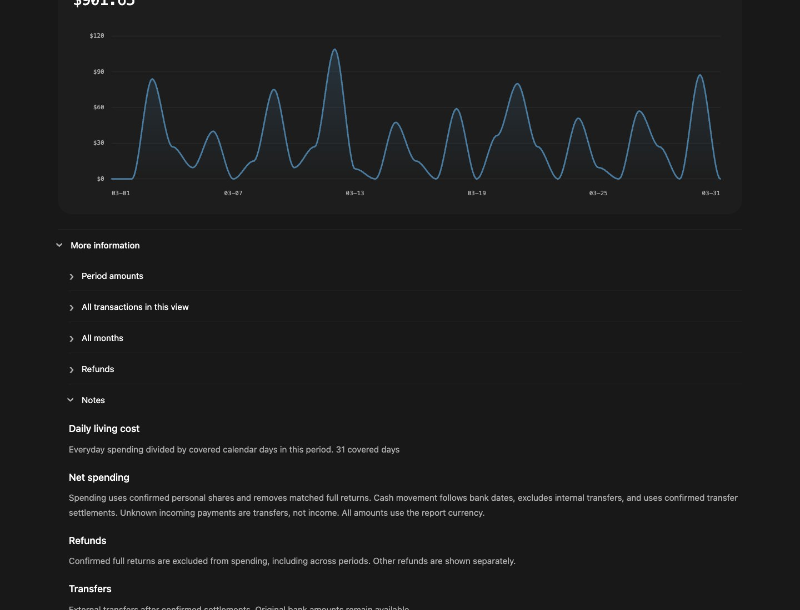
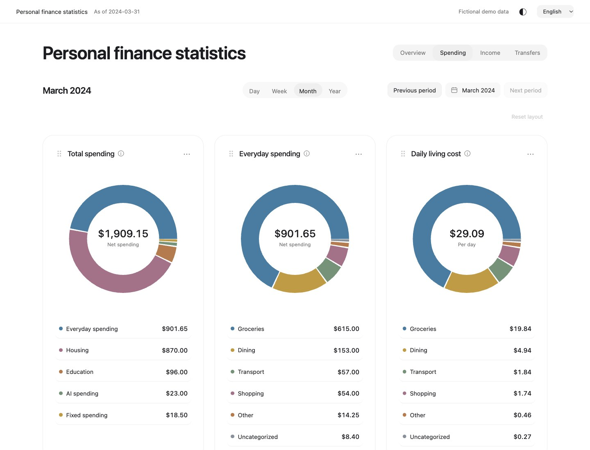
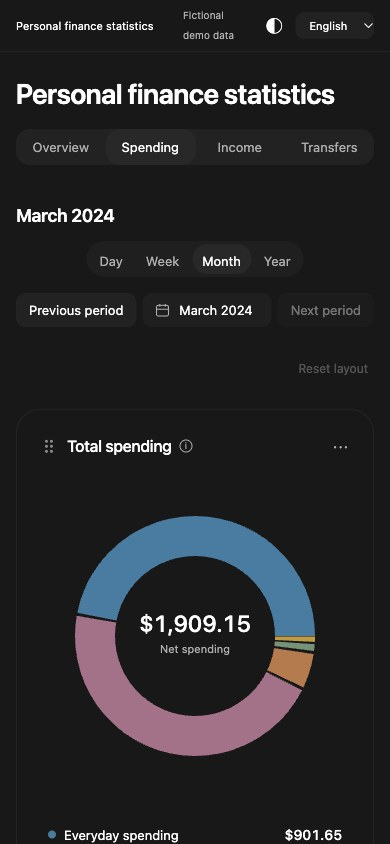

# A visual guide to Personal Finance Visualizer

[简体中文](visual-guide.zh-CN.md) · [Project home](../README.md) · [Install](../README.md#install-as-an-agent-skill) · [Input schema](../skills/personal-finance-visualizer/references/schema.md)

This is the interface included in version 1.3.0. Every screenshot uses the same entirely fictional USD dataset. The pictures are real report captures, not mockups. Click a picture to view its full-size file.

## Spending: the full picture, then the categories

The first row shows total personal spending, everyday spending and daily living cost. The second row separates fixed services, AI services and housing. Ring centers show totals; the rows below show the amounts behind each slice.

Use the buttons beside the title to change views. Day, week, month and year controls change the selected period; previous/next and the date picker move through the available data. Partial periods stop at the confirmed coverage date.


## Merchant breakdown: where a category went

Below the main rings, inspect the everyday merchant cards. The example shows groceries, dining and shopping. Unknown, transport and other everyday categories remain in the main totals and transaction details even when they are omitted from this lower merchant section.

The timeline shows everyday spending by day, or by month in the year view. Switch between area and bar charts, then select a point or bar to inspect the transactions for that date or month.


## Transaction details: inspect the original amounts

Select a ring segment or a row beneath a ring to open its transactions. The window keeps the period, count and total visible, and supports expandable search, category/account filters, column sorting, filtered totals and continuous scrolling.

Rows retain the original bank amount, personal share, personal spending and source reference. Confirmed shares affect spending only; the original bank amounts remain available. Display rounding can create small differences between the sum of displayed rows and the unrounded total.


## Income: totals, daily average and sources

Two main rings show total income and income per covered day. The next row separates confirmed salary, living allowance and other income; the timeline shows when the money arrived.

An incoming payment is not automatically income. Unknown receipts stay in transfers until their purpose is established. Own-account movements and purchase refunds are excluded from income.


## Transfers: movements and confirmed repayments

Outgoing and incoming external transfers have separate rings. The three metrics below show net transferred out, confirmed repayments and confirmed loans outstanding. The illustrated year view is clipped to the demo's January–March coverage.

Only explicitly classified loans enter the loan metrics. Confirmed settlement allocations reduce the related outgoing and incoming records; partial repayment leaves the remainder. Similar names, dates or amounts do not create a match.


## Overview: how the supplied accounts changed

The overview shows total inflow, total outflow and net change. Click any metric to inspect the rows behind it. It follows bank dates, excludes internal account movements and applies confirmed transfer settlements.

Spending and cash movement answer different questions. A confirmed return can cancel the original purchase in spending while both bank-date entries remain in the cash view. This page does not calculate a bank balance or total net worth.


## Explanations stay out of the way

Focus or hover over an information icon for a card's definition. Open More information, then Notes at the bottom for the daily-average denominator, spending basis, refunds, transfers and source limitations. Details and notes start collapsed.

Daily averages include covered calendar days with no spending. Source gaps and uncertain classifications should stay visible in the report notes rather than being silently filled in.



## Chinese, light mode and smaller screens

The language selector switches the report controls between English and Simplified Chinese. Your agent follows the language of your request unless you specify another. Original transaction descriptions and merchant names remain as supplied; changing the interface language does not rewrite your records.


The theme control switches between dark and light locally, without a network request.



At narrow widths the cards stack into one column and controls wrap. Transaction tables can scroll horizontally to retain their fields.



## Try this exact interface

Run the included demo from the repository root, then open the local URL it prints:

```bash
python3 skills/personal-finance-visualizer/scripts/report.py --demo --language en
```

The report stays in process memory while the command runs. Stop it with Ctrl+C when finished. For your own records, follow the [input schema](../skills/personal-finance-visualizer/references/schema.md) and [reconciliation workflow](../skills/personal-finance-visualizer/references/workflow.md). Export only when you choose to keep a local report.

The standalone report has no remote assets or analytics. Your agent host's handling of prompts and supplied files depends on its settings; see [privacy and limits](../README.md#privacy-and-limits). The report template does not include ChatGPT's host editing, Ask ChatGPT or publishing tools.
